# Database Entity-Relationship Diagram (ERD) & Schema Specification

This document details the PostgreSQL relational database architecture for the E-Commerce Platform.

## Architectural Overview

The schema is built around 10 primary functional domain modules:
1. **Users & Authentication** (`User`, `CustomerProfile`, `AdminProfile`, `DeliveryProfile`, `UserAddress`)
2. **Catalog & Products** (`Category`, `Brand`, `Product`, `ProductCategory`, `ProductVariant`, `MediaAsset`)
3. **Inventory & Purchasing** (`InventoryMovement`, `Supplier`, `PurchaseOrder`, `PurchaseOrderItem`)
4. **Shopping & Cart** (`Cart`, `CartItem`, `Wishlist`, `WishlistItem`)
5. **Orders & Fulfillment** (`Order`, `OrderItem`, `OrderStatusHistory`)
6. **Payments & Refunds** (`Payment`, `Refund`)
7. **Delivery & Dispatch** (`DeliveryAssignment`)
8. **Promotions & Loyalty** (`Coupon`, `LoyaltyAccount`, `LoyaltyTransaction`)
9. **Engagement & Support** (`Review`, `SupportTicket`, `SupportMessage`)
10. **Store Operations & Finance** (`StoreSetting`, `AuditLog`, `Expense`)

---

## Entity Relationship Diagram (Mermaid)

```mermaid
erDiagram
    USER ||--o| CUSTOMER_PROFILE : "has"
    USER ||--o| ADMIN_PROFILE : "has"
    USER ||--o| DELIVERY_PROFILE : "has"
    USER ||--o{ USER_ADDRESS : "owns"
    USER ||--o{ ORDER : "places"
    USER ||--o{ CART : "owns"
    USER ||--o{ WISHLIST : "owns"
    USER ||--o{ REVIEW : "writes"
    USER ||--o| LOYALTY_ACCOUNT : "has"
    
    BRAND ||--o{ PRODUCT : "manufactures"
    CATEGORY ||--o{ PRODUCT_CATEGORY : "contains"
    PRODUCT ||--o{ PRODUCT_CATEGORY : "belongs_to"
    PRODUCT ||--o{ PRODUCT_VARIANT : "has_variants"
    PRODUCT ||--o{ ORDER_ITEM : "included_in"
    PRODUCT ||--o{ CART_ITEM : "in_cart"
    PRODUCT ||--o{ REVIEW : "has_reviews"
    
    ORDER ||--o{ ORDER_ITEM : "contains"
    ORDER ||--o{ PAYMENT : "paid_by"
    ORDER ||--o{ REFUND : "refunded_by"
    ORDER ||--o| DELIVERY_ASSIGNMENT : "dispatched_via"
    ORDER ||--o{ ORDER_STATUS_HISTORY : "tracks"
    
    DELIVERY_PROFILE ||--o{ DELIVERY_ASSIGNMENT : "handles"
    SUPPLIER ||--o{ PURCHASE_ORDER : "supplies"
    PURCHASE_ORDER ||--o{ PURCHASE_ORDER_ITEM : "contains"
    LOYALTY_ACCOUNT ||--o{ LOYALTY_TRANSACTION : "records"
    SUPPORT_TICKET ||--o{ SUPPORT_MESSAGE : "contains"
```

---

## Detailed Table Schemas

### 1. `User`
- `id` (UUID, PK)
- `email` (VARCHAR, Unique Index)
- `passwordHash` (VARCHAR, Nullable for Google OAuth users)
- `name` (VARCHAR)
- `phone` (VARCHAR)
- `role` (ENUM: `CUSTOMER`, `SUPER_ADMIN`, `STORE_MANAGER`, `DELIVERY_PERSONNEL`, etc.)
- `authProvider` (VARCHAR: `email` | `google`)
- `firebaseUid` (VARCHAR, Unique Index)
- `createdAt`, `updatedAt` (TIMESTAMPTZ)

### 2. `Product`
- `id` (UUID, PK)
- `name`, `slug` (VARCHAR, Unique)
- `description` (TEXT)
- `sku` (VARCHAR, Unique)
- `priceCents` (INT) - Price stored in minor currency units (e.g. ₹499 = 49900)
- `mrpCents` (INT)
- `discountPct` (INT)
- `stock` (INT)
- `featured`, `bestSeller`, `newArrival`, `active` (BOOLEAN)
- `images` (TEXT Array) - Media keys / URLs
- `specs` (JSONB) - Specifications key-value pairs

### 3. `Order`
- `id` (UUID, PK)
- `orderNumber` (VARCHAR, Unique)
- `userId` (UUID, FK -> User.id)
- `customerName`, `email`, `phone` (VARCHAR)
- `addressId` (UUID, FK -> UserAddress.id)
- `orderStatus` (ENUM: `PENDING`, `CONFIRMED`, `PROCESSING`, `SHIPPED`, `OUT_FOR_DELIVERY`, `DELIVERED`, `CANCELLED`)
- `paymentStatus` (ENUM: `PENDING`, `PAID`, `PARTIAL`, `FAILED`, `REFUNDED`)
- `subtotalCents`, `discountCents`, `deliveryChargeCents`, `totalCents` (INT)
- `trackingNumber`, `courierName` (VARCHAR)

### 4. `DeliveryAssignment`
- `id` (UUID, PK)
- `orderId` (UUID, FK -> Order.id, Unique)
- `deliveryProfileId` (UUID, FK -> DeliveryProfile.id)
- `status` (VARCHAR: `Assigned`, `Accepted`, `Picked_Up`, `Out_for_Delivery`, `Delivered`, `Failed`)
- `otpCode` (VARCHAR)
- `proofPhotoUrl` (TEXT)
- `signatureName` (VARCHAR)
- `assignedAt`, `completedAt` (TIMESTAMPTZ)

---

## Financial Integrity & Money Storage Rules

1. All currency values are stored as **integer minor units** (`priceCents`, `totalCents`) to eliminate floating-point rounding errors.
2. Historical order prices and item descriptions are snapshotted in `OrderItem` at checkout time so subsequent product catalog updates never corrupt existing invoices.
